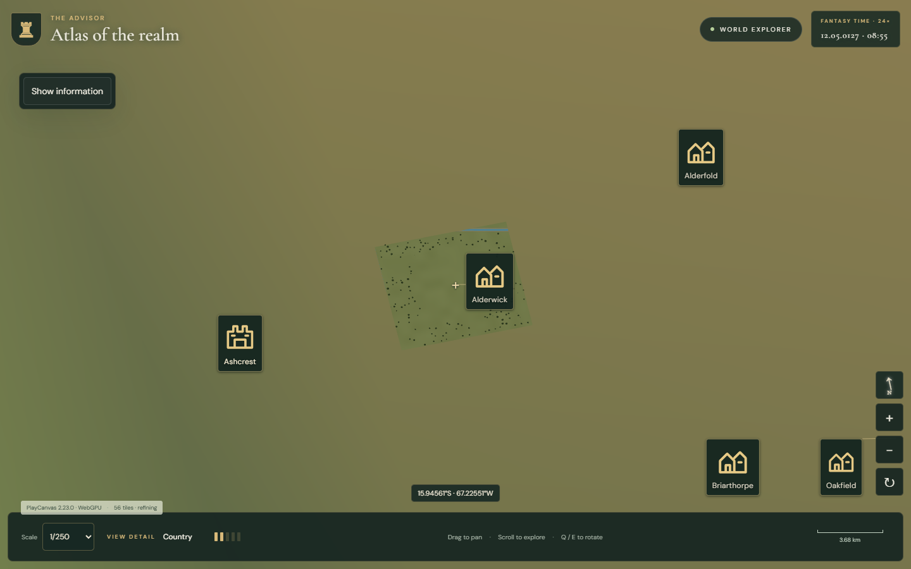
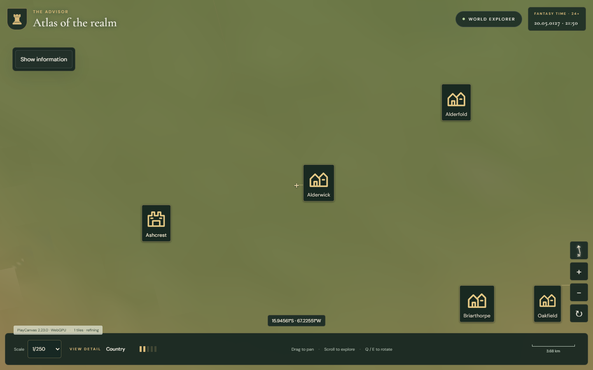
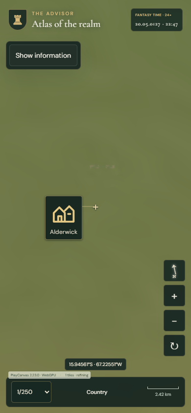

# Owner #105: zoom-out coverage proof

Native Windows Edge, same seeded home, displayed 1/250. One local run per
configuration; phone is an emulated viewport, not a physical Samsung A55.

| Backend / viewport | Before coherent terrain | Final coherent terrain | Final detail |
| --- | ---: | ---: | ---: |
| webgl2 / desktop | 54,654.0 ms | 425.4 ms | 52,293.7 ms |
| webgl2 / phone | 11,244.1 ms | 302.1 ms | 10,954.9 ms |
| webgpu / desktop | 57,845.4 ms | 445.9 ms | 52,348.7 ms |
| webgpu / phone | 11,519.9 ms | 338.8 ms | 11,031.6 ms |

Before, a previous-view square remains over differently coloured coarse ground:

Final terrain fills the view before fine details complete:

[Measurements](measurements.json) retain all eight final gesture results and all
16 unmasked 250/1000ms-to-settled comparisons. All pass unchanged mean RGB <=2
and broadly changed area <=5% limits. All captured resources pass, max one job.
Owner requested about one second as sufficient; no further latency tuning is
planned. Fine objects and cold initialization remain slower. This is useful
terrain coverage, not a claim that all objects are generated within one second.

Exact final production assets are in [asset-sha256.json](asset-sha256.json).
Failed layer/readiness, coarse-shore and redundant-centre-sampling candidates
remain outside Git. Regression scopes, retained locations and live deployment
status are documented in [ZOOM_COVERAGE.md](../../ZOOM_COVERAGE.md).
