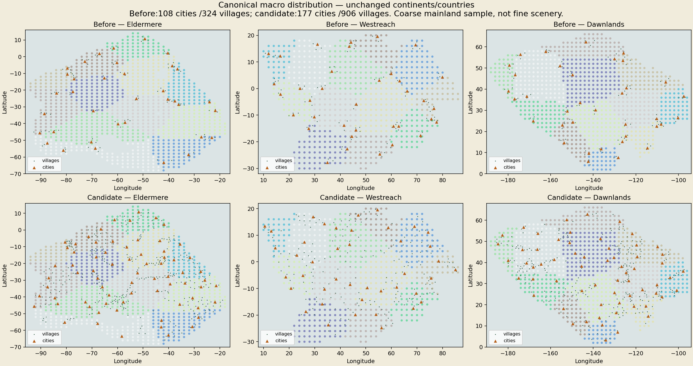
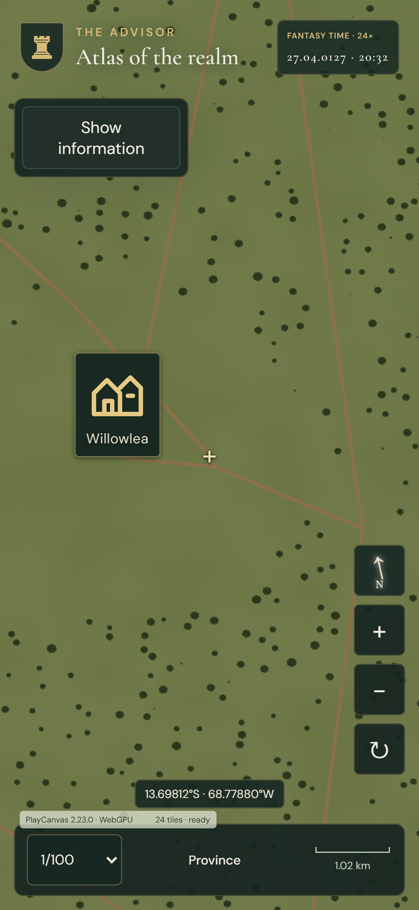
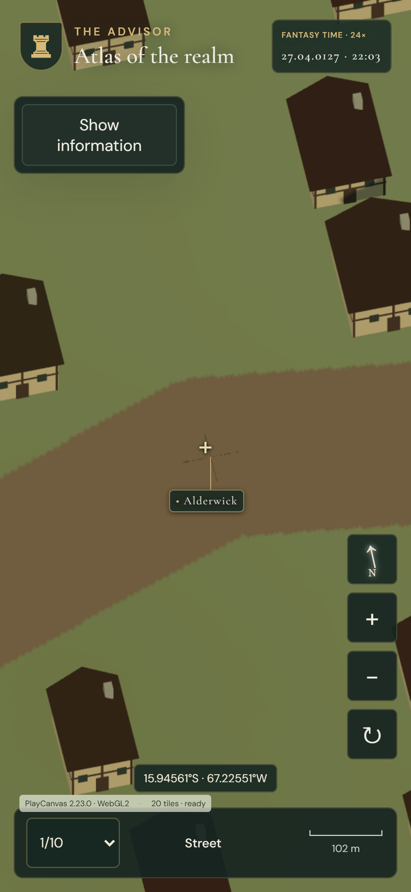

# Owner issue #91 — macro world proof

[Design, audit and validation scopes](../../MACRO_SETTLEMENT_DISTRIBUTION.md). These captures show the frozen pre-integration macro candidate; the resident integration scope is recorded in that document separately.

Actual native desktop Chrome at an A55-reference resolution/touch configuration, not physical-phone performance:

